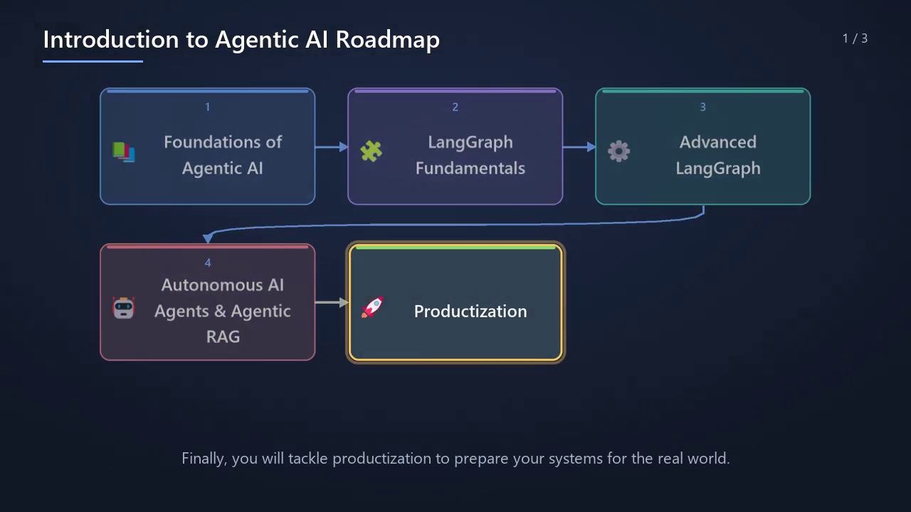
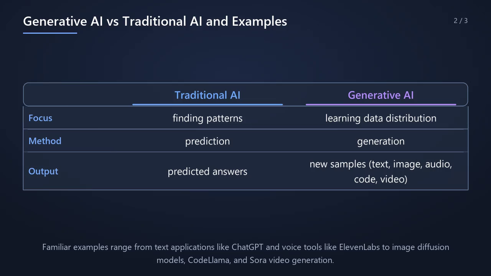
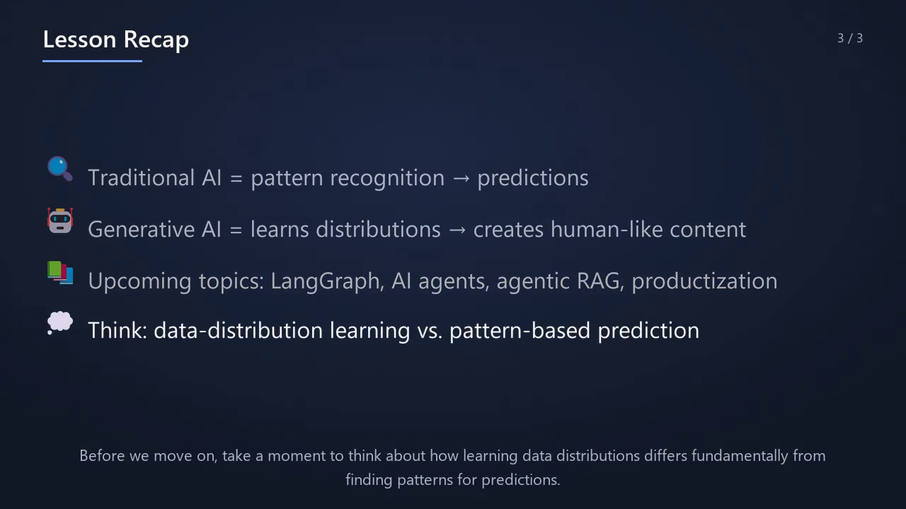

# NoteTutor AI

**Turn your notes into a narrated, animated explainer video.**

Upload handwritten notes, a PDF, a text file - or just type a topic - and
NoteTutor plans a short lesson, writes the narration, designs a visual for
every scene (concept maps, process flows, comparison tables, key points,
equations) and renders an MP4 in which each element appears and is
highlighted exactly when the narrator talks about it.



| Comparison table | Recap with key points |
|---|---|
|  |  |

## Features

- **Any material**: handwritten pages (vision model transcription), PDFs
  (text layer or scanned), `.txt`/`.md`, or a topic name.
- **Grounded teaching**: lessons stay within the source; a fact check runs on
  the notes and on every scene, and an after-render review lists any
  doubtful sentence with its timestamp.
- **Visuals chosen per scene**: concept maps, process flows, comparison
  tables, key points, typeset equations and licensed pictures - laid out by
  a deterministic engine (no overlapping boxes or labels).
- **Synced animation**: elements pop in when their sentence starts, the item
  being explained is spotlighted and pulses, and dots flow along arrows.
- **Natural narration**: Kokoro neural voice (local), equal loudness per
  sentence, background music that ducks under speech.
- **Sensible length**: about 2 minutes for a page of notes, at most ~10
  minutes for long documents.
- **Web app**: accounts, live progress, video player and download, script and
  fact review, admin dashboard.
- **Free to run**: Groq and Gemini free tiers, local voice and rendering.

## Tech stack

| Area | Technologies |
|---|---|
| Backend | Python, FastAPI, REST, JWT + httpOnly session cookie, role-based access control, Pytest |
| Database | MongoDB (users, lessons) with GridFS for notes and videos; MongoDB Atlas or local |
| Frontend | React, TypeScript, Vite, Tailwind CSS, React Router, Vitest |
| Video pipeline | Pillow, NumPy, MoviePy / FFmpeg, matplotlib (equations), Kokoro / Piper TTS |
| AI | Groq (`gpt-oss-120b`, `gpt-oss-20b`, `qwen3.8-27b` vision), Google Gemini (fallback) |
| DevOps | Docker, Docker Compose, Nginx, GitHub Actions |

## Quick start (Docker)

```bash
git clone https://github.com/akshaykumar1828/Notetutor.git
cd Notetutor
cp .env.example .env        # add GROQ_API_KEY, JWT_SECRET and MONGO_URL
```

Download the voice model (see [docs/DEVELOPMENT.md](docs/DEVELOPMENT.md#voice-models)),
then:

```bash
docker compose up --build                    # with MongoDB Atlas (MONGO_URL set)
docker compose --profile local-db up --build # or with a local MongoDB container
```

Open <http://localhost:8080>, create an account (the first account becomes
the admin) and generate a lesson.

## Command line

```bash
python -m app.pipeline.lesson_video samples/agentic_ai_notes.jpeg
python -m app.pipeline.lesson_video "How DNS resolution works"
python -m app.pipeline.lesson_video notes.pdf -o lesson.mp4 --no-music
```

| Option | Effect |
|---|---|
| `-o PATH` | output file (default `data/video/<title>.mp4`) |
| `--no-captions` / `--no-music` | turn off captions / background music |
| `--no-verify` | skip the per-scene fact check (uses less quota) |
| `--no-review` | skip the after-render review file |
| `--fresh` | ignore cached AI answers |
| `--allow-local` | continue with a local Ollama model if the online models are unavailable |

## How it works

```
source -> transcription / text extraction -> terminology check -> structure
       -> fact check -> lesson plan (length scales with the document)
       -> for each scene: narration -> fact check -> visual plan -> voice
       -> synced animation -> MP4 (+ lesson record and fact review)
```

Details: [docs/ARCHITECTURE.md](docs/ARCHITECTURE.md).

## Evaluation

| Measure | Result |
|---|---|
| Layout engine, 1,200 random plans | 100% no overlaps, in bounds, correct connectors |
| Handwriting transcription (CER) | 19.3% local baseline -> 0-3.5% current |
| Narration sync | 100% of elements shown during their sentence, A/V drift 45 ms |
| Faithfulness (LLM judge) | 0% of claims contradict the source |

Method and limitations: [evaluation/RESULTS.md](evaluation/RESULTS.md).

## Project structure

```
app/
  api/           FastAPI app: auth, lessons, admin, background worker
  pipeline/      end-to-end lesson generation (CLI entry point)
  vision/        page transcription and structure extraction
  teaching/      lesson planning
  content/       scene narration and sentence splitting
  knowledge/     fact checks
  video/         visual planning, layout engine, animator, renderer
  audio/         text-to-speech and background music
  common/        LLM client (Groq, Gemini, Ollama), paths
frontend/web/    React + TypeScript web app (Vite, Tailwind)
evaluation/      evaluation scripts and results
tests/           Pytest suite (API, layout, narration sync, ingestion)
samples/         example handwritten notes
docs/            architecture and development guides
```

## Development

Setup, environment variables, running without Docker and tests:
[docs/DEVELOPMENT.md](docs/DEVELOPMENT.md).

```bash
pytest                          # backend (no API keys or database needed)
cd frontend/web && npm test     # frontend
```
